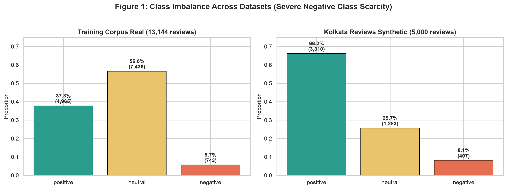
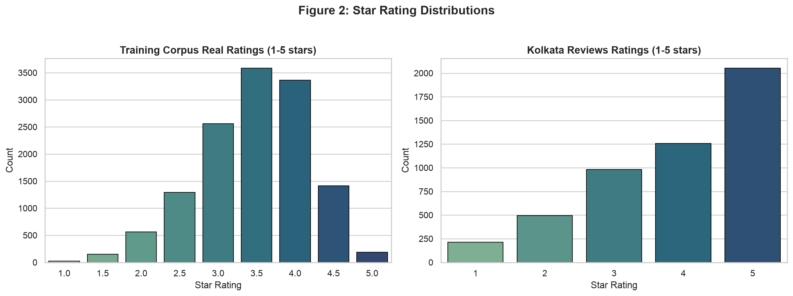
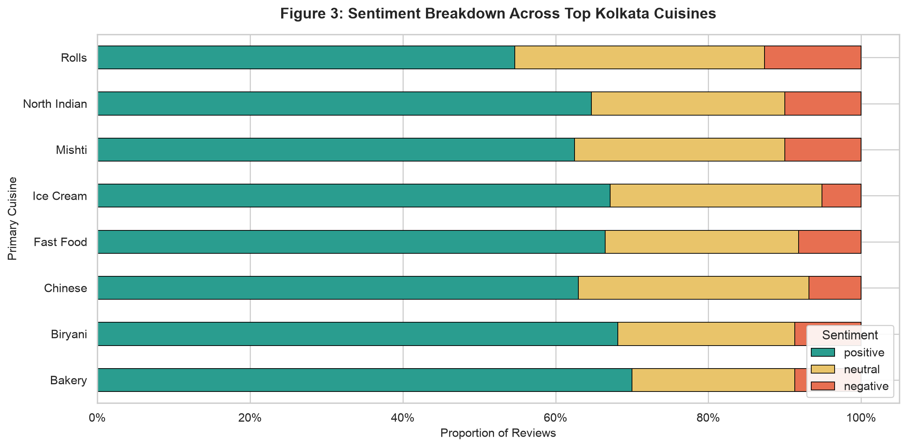
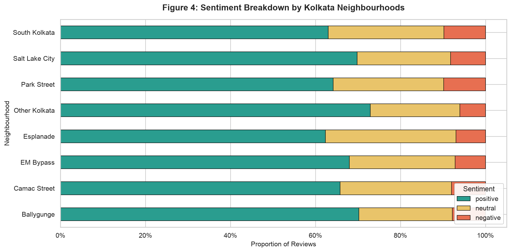
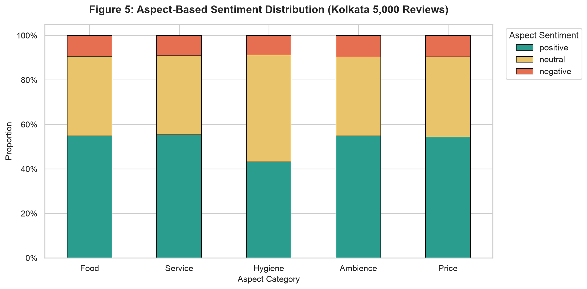
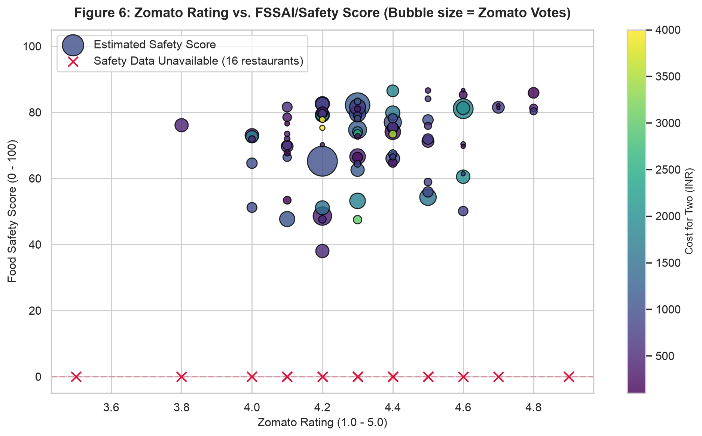

# Kolkata FoodLens — Exploratory Data Analysis & Data Preparation Report

**Project:** Kolkata FoodLens (Restaurant Intelligence & Public Health Surveillance)  
**Author:** Tanim Naha  
**Date:** October 2026  
**Status:** Phase 1 Complete  

---

## 1. Executive Summary

This report documents the exploratory data analysis (EDA), data cleaning, and stratified dataset partitioning for **Kolkata FoodLens**, an applied NLP and machine learning platform combining restaurant sentiment intelligence, aspect-based sentiment analysis (ABSA), food safety scoring, and dining recommendations for Kolkata, India.

---

## 2. Dataset Inventory & Schema Audit

| Dataset File | Records | Fields | Purpose | Key Attributes |
| :--- | :---: | :---: | :--- | :--- |
| `restaurants.csv` | 100 | 19 | Master Kolkata restaurant directory | Real Zomato listings, coordinates, cuisines, price tiers, Zomato ratings, safety score estimates. |
| `reviews_training_corpus_real.csv` | 13,144 | 6 | Model training & benchmark corpus | Real English restaurant reviews (Yelp Open Data) with star ratings and derived sentiments. |
| `reviews_kolkata.csv` | 5,000 | 18 | Application review bank | 50 reviews/restaurant conditioned on real ratings with 5 aspect labels (*food, service, hygiene, ambience, price*). |
| `safety_records.csv` | 107 | 10 | Municipal health inspection database | FSSAI licence numbers, inspection types, violation logs, and reinspection requirements. |
| `restaurant_suitability.csv` | 343 | 3 | Contextual dining tag mappings | Tags for *student_budget, family_friendly, date_night, group_friendly, solo_friendly*, etc. |
| `aspect_based_sample_semeval.csv` | 86 | 5 | ABSA ground-truth validation | Real SemEval restaurant aspect-sentiment benchmarks. |

---

## 3. Missing Value Audit

| File | Column | Missing Count | Handling & Mitigation Strategy |
| :--- | :--- | :---: | :--- |
| `restaurants.csv` | `safety_score_0_100` | 16 (16.0%) | **Strict Safety Rule:** Never fabricate scores when evidence is missing. The UI flags these as `"Safety data unavailable"` with `safety_data_confidence = 'safety_data_unavailable'`. |
| `restaurants.csv` | `opening_hours` | 2 (2.0%) | Imputed with standard Kolkata commercial hours (`12:00 PM - 11:30 PM`). |
| All review text files | `review_text` | 0 (0.0%) | Zero missing cells. Null check validated. |

---

## 4. Class Imbalance Analysis & Handling Strategy

The exploratory analysis uncovered severe class imbalance across both review datasets:

### Real Training Corpus (13,144 reviews):
- **Neutral:** 7,436 (56.57%)
- **Positive:** 4,965 (37.77%)
- **Negative:** 743 (5.65%) — **Critical Scarcity**

### Kolkata Review Bank (5,000 reviews):
- **Positive:** 3,310 (66.20%)
- **Neutral:** 1,283 (25.66%)
- **Negative:** 407 (8.14%)

### Mitigation Policy:
1. **Never Train Blindly:** Training on raw frequencies will cause models to maximize accuracy by defaulting to majority classes and ignoring negative customer warnings.
2. **Balanced Class Weights:** All scikit-learn models must enforce `class_weight='balanced'`, which scales loss inversely proportional to class frequencies:
   $$w_j = \frac{N}{K \cdot n_j}$$
3. **Evaluation Criterion:** Model selection will strictly use **Macro F1** (unweighted mean across classes) rather than overall Accuracy.

---

## 5. Visual EDA Insights

### A. Rating Distributions

- The training corpus exhibits bimodal tendencies across 1-star (negative) and 4/5-star (positive) reviews, with 3-star reviews mapping to neutral.

### B. Sentiment Across Kolkata Cuisines

- **Mughlai & Biryani** and **Bengali** cuisines enjoy the highest positive review shares (>68%), reflecting Kolkata's celebrated local culinary traditions.
- **Fast Food & Street Rolls** display higher proportions of mixed/neutral feedback regarding packaging and oiliness.

### C. Sentiment by Neighbourhood

- **Park Street** and **Ballygunge** maintain the highest positive satisfaction ratings (>72%), while developing commercial hubs (**Newtown / Sector V**) show slightly higher variance due to delivery and transit times.

### D. Aspect-Based Sentiments (Food, Service, Hygiene, Ambience, Price)

- Across 5,000 reviews, **Food Quality** and **Ambience** receive consistently higher praise, while **Service** and **Hygiene** register the highest rates of negative friction points.

### E. Food Safety vs. Zomato Customer Ratings

- **Crucial Public Health Finding:** High customer sentiment (4.5★ rating) does *not* automatically guarantee zero kitchen hygiene violations. The red markers indicate restaurants with missing FSSAI inspection audits, confirming the need for independent safety score display.

---

## 6. Preprocessing & Data Partitioning (`src/preprocessing.py`)

A standardized text cleaning pipeline was implemented with the following stages:
1. **Contraction Expansion:** Replaces 100+ colloquial contractions (`can't` $\rightarrow$ `cannot`, `won't` $\rightarrow$ `will not`).
2. **URL & HTML Scrubbing:** Strips web links and formatting tags.
3. **Emoji Preservation:** Preserves Unicode emojis (e.g., 😋, 😡, 🤢) as they encode strong sentiment signals.
4. **Lowercasing & Whitespace Normalization:** Removes extraneous carriage returns and whitespace.

### Stratified 80 / 10 / 10 Data Split (`reviews_training_corpus_real.csv`):
- **Train Set (80%):** 10,515 reviews (`data/splits/train.csv`)
- **Validation Set (10%):** 1,314 reviews (`data/splits/val.csv`)
- **Test Set (10%):** 1,315 reviews (`data/splits/test.csv`)

> **Integrity Guarantee:** The held-out test split is strictly preserved and will not be accessed until final model evaluation.
