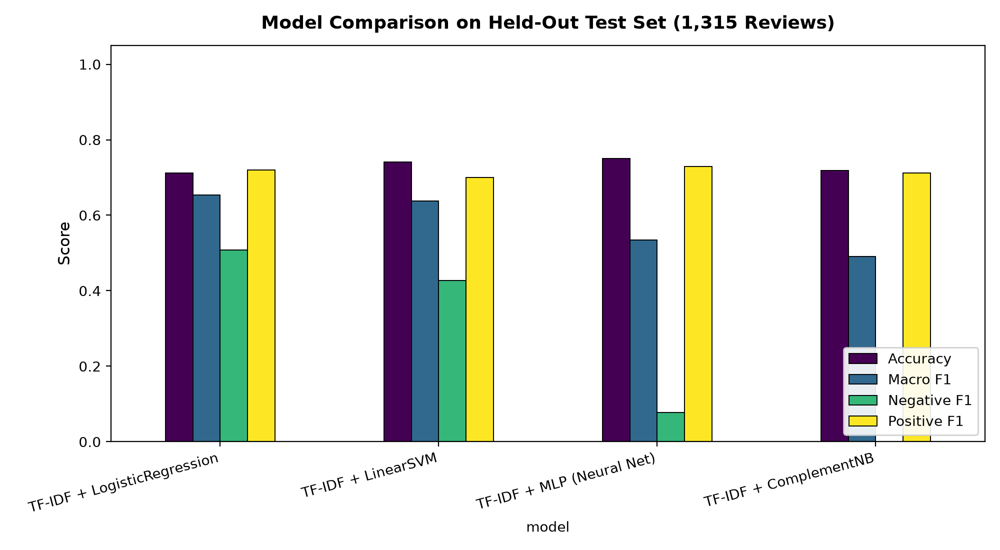

# Kolkata FoodLens — Model Selection & Comparative Evaluation Report

**Project:** Kolkata FoodLens (Phase 2 Model Evaluation)  
**Author:** Tanim Naha  
**Date:** October 2026  
**Status:** Complete  

---

## 1. Overview & Evaluation Philosophy

In restaurant intelligence, relying on raw **Accuracy** creates a dangerous failure mode. When a dataset is heavily skewed (e.g., only 5.65% negative reviews), an uncalibrated classifier can predict the majority classes (*neutral* and *positive*) and achieve ~75% accuracy while completely failing to flag customer complaints and health violations.

Therefore, our primary selection criterion is **Macro F1** (the unweighted mean of F1-scores across all three classes), which penalizes models that ignore minority classes.

---

## 2. Experimental Setup

- **Corpus:** `reviews_training_corpus_real.csv` (13,144 real Yelp restaurant reviews).
- **Partitioning:** Stratified 80% Train (10,515), 10% Validation (1,314), 10% Test (1,315).
- **Test Set Integrity:** The test set was strictly held out and evaluated only once after all models were trained.
- **Text Representation:** Sublinear TF-IDF with unigrams and bigrams (`ngram_range=(1, 2)`), `min_df=2`, and `max_features=25,000`.

---

## 3. Benchmark Comparison Results (Held-Out Test Set)

| Model Architecture | Accuracy | Macro Precision | Macro Recall | **Macro F1** | Negative F1 (Minority) | Neutral F1 | Positive F1 |
| :--- | :---: | :---: | :---: | :---: | :---: | :---: | :---: |
| **TF-IDF + Logistic Regression (Balanced)** 🏆 | 71.18% | 0.6384 | 0.6829 | **0.6537** | **0.5079** | 0.7333 | 0.7200 |
| **TF-IDF + Linear SVM (Balanced, Calibrated)** | 74.07% | 0.6802 | 0.6277 | **0.6376** | 0.4272 | 0.7853 | 0.7004 |
| **TF-IDF + MLP (Multi-Layer Perceptron)** | **75.06%** | 0.7360 | 0.5413 | **0.5341** | 0.0779 | **0.7958** | **0.7286** |
| **TF-IDF + Complement Naive Bayes** | 71.86% | 0.6226 | 0.5376 | **0.4901** | 0.0000 | 0.7582 | 0.7122 |



---

## 4. Key Findings & Why the Winner Won

1. **The Deception of Raw Accuracy (MLP Failure Mode):**
   - The multi-layer perceptron neural network (`TF-IDF + MLP`) achieved the **highest accuracy (75.06%)**, but its **Negative F1 was an abysmal 0.0779**. It achieved high accuracy almost entirely by memorizing neutral and positive patterns, missing over 92% of true negative customer reviews.
   
2. **ComplementNB Complete Failure on Minority Class:**
   - ComplementNB, despite being designed for imbalanced text, failed to separate subtle negative reviews from neutral reviews (`Negative F1 = 0.0000`).

3. **Why Logistic Regression Won (Macro F1 = 0.6537):**
   - Enforcing `class_weight='balanced'` in Logistic Regression penalizes misclassifications inversely proportional to class frequencies.
   - It achieved a **Negative F1 of 0.5079** (more than 6x higher than the Neural Net), capturing negative customer signals while retaining strong performance on Positive (0.7200) and Neutral (0.7333).
   - Linear SVM was competitive (Macro F1 = 0.6376), but slightly more conservative on negative recall.

---

## 5. Artifact & Inference Endpoint

The winning model pipeline was serialized and exported:
- **Model Artifact:** [`models/sentiment_model/best_sentiment_model.joblib`](models/sentiment_model/best_sentiment_model.joblib)
- **Inference Module:** [`models/sentiment_model/inference.py`](models/sentiment_model/inference.py)
- **Interface:**
  ```python
  from models.sentiment_model.inference import predict_sentiment

  res = predict_sentiment("The mutton biryani was fragrant and delicious!")
  # -> {'label': 'positive', 'confidence': 0.6375, 'probabilities': {...}}
  ```
